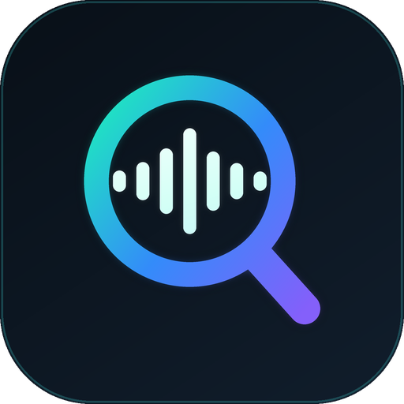

<p align="center">
  
</p>

<h1 align="center">Spotiseek</h1>

<p align="center">
  Pegá un enlace de Spotify y descargá tus canciones desde Soulseek, con respaldo en YouTube Music.<br>
  Aplicación de escritorio para Windows.
</p>

<p align="center">
  <a href="../../releases/latest"><b>Descargar la última versión</b></a>
</p>

<!-- Reemplazá esta línea por una captura real de la app: -->
<!-- <p align="center"></p> -->

---

## ⚠️ Leé esto primero

**Esta aplicación fue creada por una persona que no sabe programar**, con la ayuda de varias herramientas de inteligencia artificial (entre ellas Claude, de Anthropic). El autor dirigió el proyecto, probó la app y decidió cómo debía funcionar, pero **no revisó el código línea por línea y no puede garantizar que esté libre de errores**.

Qué significa esto para vos:

- El programa se ofrece **tal cual, sin ninguna garantía** (ver [LICENSE](LICENSE)).
- Puede tener errores. Si encontrás uno, reportalo en [Issues](../../issues) y se va a intentar arreglar, pero no hay compromiso de plazos ni de soporte.
- El código es abierto justamente para que cualquiera pueda revisarlo. Si sabés programar y ves algo mejorable o inseguro, tu aporte es bienvenido.
- Usalo bajo tu propia responsabilidad.

**Sobre el contenido que descargás:** Soulseek es una red entre usuarios, y los archivos los comparte gente de todo el mundo. Spotiseek solo automatiza la búsqueda y la descarga. **Vos sos responsable de respetar las leyes de derechos de autor de tu país** y de descargar solo música que tengas derecho a obtener. Si una canción te gusta, comprala o apoyá al artista. Ver el [aviso legal](#aviso-legal).

---

## Qué es

Spotiseek toma un enlace de Spotify (canción, álbum, EP o playlist), arma la lista de temas y los busca y descarga automáticamente a través de [slskd](https://github.com/slskd/slskd), un cliente de Soulseek. Si una canción no aparece en Soulseek, puede intentar conseguirla desde YouTube Music y convertirla a MP3.

**No necesita cuenta de Spotify ni claves de desarrollador.** Solo lee la información pública del enlace (título, artista, álbum y duración).

## Características

- Acepta enlaces de **canciones, álbumes, EPs y playlists** de Spotify.
- Busca en Soulseek y **elige solo el mejor resultado**: prioriza MP3 de 320 kbps, prefiere las versiones *Extended Mix* y, si no hay, prueba otros formatos.
- **Varias descargas en paralelo**, con la búsqueda siguiente lista apenas empieza una descarga.
- Si un resultado no responde o se tranca, **pasa solo al siguiente** (los tiempos se pueden configurar).
- **Respaldo con YouTube Music** (opcional): descarga el audio y lo convierte a MP3.
- Lista con filtros (en proceso, pendientes, completadas, atención) y buscador.
- **Selección múltiple**: Ctrl+clic, Mayús+clic y "Seleccionar todas", con acciones en lote (descargar, reintentar, cancelar, quitar).
- **Pausar todo** y **cancelar todo**.
- Ventana de **Opciones** por canción para elegir a mano entre todos los resultados encontrados.
- Los archivos quedan **solo como audio**, con el nombre `Canción - Artista` (configurable).
- Menú de **Ajustes**: carpeta de descargas, tiempos de espera, cantidad de descargas simultáneas y más.
- **Instalador propio** y actualizaciones desde la misma app.

## Requisitos

- Windows 10 u 11 (64 bits).
- Conexión a internet.
- Una **cuenta de Soulseek** (es gratis; si el usuario no existe, Soulseek lo crea al iniciar sesión por primera vez).

## Instalación

1. Andá a la página de [**Releases**](../../releases/latest) y descargá **`Instalar_Spotiseek.exe`**.
2. Ejecutalo y seguí los pasos. No necesita permisos de administrador.
3. La primera vez que abras Spotiseek te va a pedir tu usuario y contraseña de Soulseek.

> **Windows puede mostrar un aviso azul ("Windows protegió su PC").** Pasa porque el instalador no está firmado digitalmente (la firma cuesta dinero cada año). Para continuar: **Más información → Ejecutar de todas formas**.
> Algunos antivirus pueden marcar el programa por error (es habitual en aplicaciones hechas con Python). Si querés comprobar el archivo, podés comparar su huella con la publicada en `SHA256SUMS.txt` o subirlo a [VirusTotal](https://www.virustotal.com).

Para desinstalar: *Configuración de Windows → Aplicaciones → Spotiseek → Desinstalar*. Tu música descargada nunca se borra.

## Cómo se usa

1. Copiá un enlace de Spotify (por ejemplo `https://open.spotify.com/playlist/...`).
2. Pegalo arriba y tocá **Importar**.
3. Tocá **Descargar lista**. Spotiseek busca y descarga cada tema.
4. Las canciones que no se encontraron quedan en **Atención**. Desde ahí podés **Reintentar**, **Opciones** (elegir un resultado a mano) o **YouTube** (descargar de YouTube Music).
5. Tocá **Abrir carpeta** para ver tus archivos.

### Atajos

| Acción | Cómo |
|---|---|
| Seleccionar varias canciones sueltas | Ctrl + clic |
| Seleccionar un rango | Mayús + clic |
| Seleccionar todas | Botón "Seleccionar todas" o Ctrl + A |
| Quitar la selección | Esc |
| Menú de acciones | Clic derecho |

## Preguntas frecuentes

**¿Dónde se guardan las canciones?**
En la carpeta **Descargas de Windows → Spotiseek**, o en la que elijas en *Ajustes → Carpeta de descargas*.

**¿Qué calidad tienen?**
Lo que comparta cada usuario de Soulseek. Se prioriza MP3 de 320 kbps. Las descargas de YouTube Music se codifican a MP3 de 320 kbps, pero YouTube no ofrece esa calidad de origen (el audio original ronda los 128–160 kbps), así que no pueden sonar mejor que eso.

**Una canción dice "Sin match".**
Nadie conectado la compartía en ese momento, o el nombre no coincidió. Probá **Reintentar** más tarde, **Opciones** para elegir a mano, o **YouTube**.

**YouTube da error 403.**
YouTube cambia seguido. La app descarga sola la versión más reciente de sus componentes y reintenta; si sigue fallando, probá de nuevo más tarde y reportalo en Issues con el mensaje completo.

**¿Por qué tarda en abrir el instalador?**
El instalador contiene todo el programa y primero se descomprime a sí mismo.

**¿Funciona en Mac o Linux?**
No por ahora; está pensado para Windows.

## Privacidad y seguridad

- **Datos que se envían al creador:** al abrir la app (y solo si lo aceptás en el primer inicio) se envían tu **dirección IP**, tu **nombre de usuario de Soulseek** (**nunca la contraseña**), la versión de la app, tu sistema operativo y un identificador anónimo de la instalación. Sirven para mejorar la app y para poder suspender el acceso ante un mal uso. No se envía nada de tu música ni de tus listas. Si no aceptás, la app no se puede usar.
- Tu usuario y contraseña de Soulseek se guardan **en tu computadora**, en el archivo `slskd\slskd.yml` dentro de la carpeta de instalación, **en texto plano**. No lo compartas ni lo subas a ningún lado.
- La app se conecta a: Spotify (para leer los enlaces), la red Soulseek (a través de slskd), YouTube (solo si usás el respaldo) y GitHub (para buscar actualizaciones y descargar componentes de YouTube).
- Las **actualizaciones** descargan archivos `.py` nuevos desde GitHub y los ejecutan. Se comprueba su integridad con un hash SHA-256, pero la confianza recae en este repositorio. La app busca e instala las actualizaciones **automáticamente cada vez que se abre**.

## Compilar desde el código (para desarrolladores)

Requisitos: Python 3.11 o superior en Windows.

```bat
pip install -r requirements.txt
python lanzador.py
```

Para generar el programa y el instalador hacen falta además `slskd\slskd.exe` (descargado de [slskd](https://github.com/slskd/slskd/releases)) y `ffmpeg\ffmpeg.exe` y `ffprobe.exe` (por ejemplo de [gyan.dev](https://www.gyan.dev/ffmpeg/builds/)), que **no están en este repositorio**. Después:

```bat
empaquetado\compilar.bat
empaquetado\compilar_instalador.bat
```

El resultado queda en `empaquetado\salida\Instalar_Spotiseek.exe`.

## Tecnologías y créditos

Spotiseek no existiría sin estos proyectos. Gracias a sus autores:

- [slskd](https://github.com/slskd/slskd), cliente de Soulseek (AGPL-3.0)
- [yt-dlp](https://github.com/yt-dlp/yt-dlp), descargas de YouTube (Unlicense)
- [FFmpeg](https://ffmpeg.org), conversión de audio (GPL/LGPL según la compilación)
- [CustomTkinter](https://github.com/TomSchimansky/CustomTkinter), interfaz (MIT)
- [Pillow](https://python-pillow.org), imágenes (HPND)
- [Requests](https://requests.readthedocs.io), conexiones HTTP (Apache-2.0)
- [Deno](https://deno.com), motor JavaScript para YouTube (MIT)

Detalle en [THIRD_PARTY_NOTICES.md](THIRD_PARTY_NOTICES.md).

## Aviso legal

- Spotiseek es un proyecto independiente y **no tiene relación con Spotify AB, Soulseek, Google/YouTube ni ninguna otra marca mencionada**. Los nombres pertenecen a sus dueños.
- La app **no descarga nada de Spotify**: solo lee los datos públicos de un enlace para saber qué canciones buscar.
- Descargar material protegido por derechos de autor sin permiso puede ser ilegal en tu país, y el uso de YouTube fuera de sus condiciones puede violar sus términos de servicio. **El uso que hagas de la aplicación es exclusivamente tu responsabilidad.** El autor no se hace responsable por daños, pérdidas ni consecuencias legales derivadas de su uso.
- Esto es información general y no constituye asesoramiento legal.

## Reportar un error o sugerir algo

Abrí un [Issue](../../issues/new/choose). Para poder ayudarte, incluí: la versión (aparece arriba a la derecha en la app), qué hiciste, qué esperabas que pasara y qué pasó. Si hay un mensaje de error, copialo completo. **Nunca pegues tu contraseña de Soulseek.**

## Licencia

El código de Spotiseek se publica bajo la [licencia MIT](LICENSE). Los programas de terceros que se incluyen en el instalador (slskd, FFmpeg) mantienen sus propias licencias.

---

### English summary

**Spotiseek** is a Windows desktop app that imports Spotify links (track, album, EP or playlist) and downloads the songs through Soulseek (using [slskd](https://github.com/slskd/slskd)), with an optional YouTube Music fallback converted to MP3. It needs no Spotify account. Download `Instalar_Spotiseek.exe` from the [Releases](../../releases/latest) page.

**Disclaimer:** this app was built by someone who does not know how to program, using several AI tools (including Claude by Anthropic). It is provided *as is*, without warranty, and may contain bugs. You are solely responsible for complying with copyright laws in your country. Not affiliated with Spotify, Soulseek or YouTube.
